<p align="center"></p>

# rune codex page

[](https://github.com/abraira85/rune-codex-page/actions/workflows/validate.yml)
[](./LICENSE)
[](./CONTRIBUTING.md)
[](./CODE_OF_CONDUCT.md)

> Production-tested prompts, roles and configs for **Claude**, **Codex**, and (piloting) **Antigravity** — private by default, public when ready.

Everything here has actually been used somewhere real. Every item is tagged `production` or `experimental` — nothing ships just to pad the count.

## `~ ❯ ls catalog/`

Organized by **area** first — what you're looking for — then by tool and type:

| Area | For |
|---|---|
| [`engineering/`](./catalog/engineering) | General software development, architecture, code reviews |
| [`database/`](./catalog/database) | Data modeling, migrations, SQL, query optimization |
| [`devops/`](./catalog/devops) | Infrastructure as code, CI/CD pipelines, cloud, reliability |
| [`security/`](./catalog/security) | Security auditing, threat modeling, vulnerability remediation |
| [`data-ai/`](./catalog/data-ai) | ML engineering, RAG pipelines, LLM evaluation, embeddings |
| [`qa/`](./catalog/qa) | Test plans, QA strategy, E2E test suites, regression |
| [`product/`](./catalog/product) | PRD authoring, user stories, scrum facilitation, roadmaps |
| [`sales/`](./catalog/sales) | Sales engineering, enterprise RFPs, targeted SDR outreach |
| [`customer-success/`](./catalog/customer-success) | Tier-2/3 technical support, churn analysis, retention |
| [`marketing/`](./catalog/marketing) | Technical SEO, developer marketing, social changelogs |
| [`it-ops/`](./catalog/it-ops) | IT administration, Zero Trust identity, helpdesk support |
| [`operations/`](./catalog/operations) | Revenue operations (RevOps), SaaS procurement, BizOps |
| [`communications/`](./catalog/communications) | PR & media relations, internal comms, crisis management |
| [`design-ux/`](./catalog/design-ux) | Design system tokens, UX wireframes, accessibility review |
| [`content/`](./catalog/content) | Technical documentation, user manuals, API reference docs |
| [`business/`](./catalog/business) | Business strategy, executive decision support, team alignment |
| [`finance/`](./catalog/finance) | Expense auditing, FP&A modeling, cash flow & runway |
| [`hr/`](./catalog/hr) | Technical talent sourcing, onboarding, compensation bands |
| [`legal/`](./catalog/legal) | Commercial contracts, IP/patents, open source licensing |

Each area repeats the unified structure across `claude/{agents,skills,mcp,hooks}`, `codex/{agents-md,prompts}`, and `antigravity/{agents,skills,mcp,hooks}`.

## `~ ❯ open docs/` (Web UI Explorer)

Prefer a graphical interface? Rune Codex includes a **zero-dependency static Web UI** in [`docs/`](./docs) (ready for GitHub Pages):

- **Instant Full-Text Search**: Filter across 454+ agents, prompts, and tools in under 5ms.
- **Faceted Filters**: Filter by platform (`Claude`, `Codex`, `Antigravity`), tool type (`Agents`, `Skills`, `MCP`, `Prompts`), domain area (19 areas), and production status.
- **One-Click Actions**: Modal previews with instant "Copy Prompt" and "Copy Install Command" clipboard buttons.

To run locally:
```bash
python3 -m http.server 8080 --directory docs
```
Or view online once GitHub Pages is enabled on your fork.


## `~ ❯ cat CONVENTIONS.md`

Every item carries the same front-matter:

```yaml
---
name: short-identifier
status: production | experimental
context: "where and how it's actually used"
---
```

- **`production`** — running somewhere real, right now.
- **`experimental`** — still being tested, not yet trusted.

Full format in [`TEMPLATE.md`](./TEMPLATE.md). Every PR is checked automatically by [`scripts/validate.py`](./scripts/validate.py) in CI — see the badge above.

## `~ ❯ man install`

No package manager, but there is a small installer — it extracts the real
payload (the tool-relevant front-matter + the actual prompt) and drops it
where the target tool expects it, instead of you copying the whole
catalog file by hand:

```
python3 scripts/install.py catalog/qa/claude/agents/qa-lead.md
python3 scripts/install.py catalog/qa/claude/agents/qa-lead.md --target ../my-project
```

| Item type | Behavior |
|---|---|
| `<area>/claude/agents/*.md` | writes `.claude/agents/<name>.md` |
| `<area>/claude/skills/*/SKILL.md` | writes `.claude/skills/<name>/SKILL.md` |
| `<area>/claude/mcp/*.md` | prints only — JSON configs need a human to merge them |
| `<area>/claude/hooks/*.md` | prints only — same reasoning |
| `<area>/codex/agents-md/*.md` | writes `AGENTS.md` at the target root (refuses to overwrite an existing one without `--force`) |
| `<area>/codex/prompts/*.md` | prints only — no fixed destination |
| `<area>/antigravity/agents/*.md` | writes `.agents/agents/<name>.md` |
| `<area>/antigravity/skills/*/SKILL.md` | writes `.agents/skills/<name>/SKILL.md` |
| `<area>/antigravity/mcp/*.md` | prints only — merge into `.agents/mcp_config.json` by hand |
| `<area>/antigravity/hooks/*.md` | prints only — merge into `.agents/hooks.json` by hand |

It never overwrites an existing file silently. Prefer doing it by hand?
Every catalog file still reads fine on its own — the front-matter (`name`,
`status`, `context`) is this repo's metadata, and the fenced block under
"Prompt / instructions" is the exact content to paste.

## `~ ❯ man contributing`

Contributions are welcome — this isn't a solo drop, it's meant to grow. Start with [`CONTRIBUTING.md`](./CONTRIBUTING.md) for the workflow, [`CODE_OF_CONDUCT.md`](./CODE_OF_CONDUCT.md) for how we treat each other, and [`SECURITY.md`](./SECURITY.md) if what you found is a security issue rather than a bug. Everyone who lands an item gets listed in [`CONTRIBUTORS.md`](./CONTRIBUTORS.md).

Releases follow [Semantic Versioning](https://semver.org/) and are tracked in [`CHANGELOG.md`](./CHANGELOG.md).

## `~ ❯ roadmap`
 
- [x] First real items in the catalog (`qa/` team: 19 agents, 4 skills, 3 MCP, 1 hook)
- [x] A generated `index.json` so the catalog is machine-readable
- [x] Tagged `v0.1.0` once there's enough here to call a first release
- [x] Expanded business domains (`hr/`, `finance/`, `marketing/`) & CLI search (`rune-search.py`) — tagged `v0.2.0`
- [x] Complete enterprise coverage (`sales/`, `customer-success/`, `product/`), static Web UI explorer (`docs/`), prompt quality linter (`lint_prompts.py`), and 370 validated items — tagged `v0.3.0`
- [x] Deep enterprise scaling (26 detailed roles, 3 new areas `it-ops/`, `operations/`, `communications/`, MCPs for HubSpot/Jira/Google Workspace, and 454 validated items) — tagged `v0.4.0`

## `~ ❯ whoami`

Built by [Rober de Ávila Abraira](https://github.com/abraira85) — [outboss.io](https://outboss.io)
